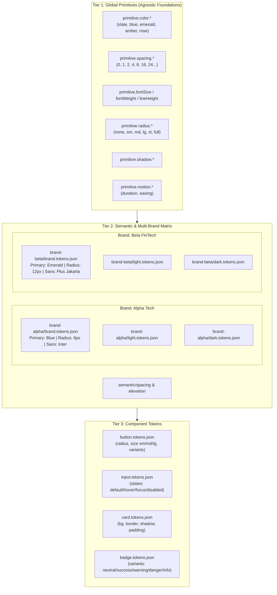

# ⚡ Multi-Brand Tokenized Design System Template

A production-grade, state-of-the-art design token system built for **maximum scalability (multi-branding)**, **maintainability**, and **cross-platform portability**.

Built according to the **W3C Design Tokens Community Group (DTCG)** specification and compiled using **Style Dictionary v5** (native ESM).

---

## 🎯 Architectural Highlights

- **W3C DTCG Format Compliance**: Every token uses standard `$value`, `$type`, and `$description` properties.
- **3-Tier Hierarchy**: Clean separation between **Primitives**, **Semantic Contexts**, and **Component Tokens**.
- **Multi-Brand & Multi-Theme Matrix**: Effortlessly manage $N$ brands and $M$ themes (e.g. Light/Dark) with automated CSS cascade scoping.
- **Zero-Runtime Overhead**: Fully compiled to modern **CSS Custom Properties** with `[data-brand]` and `[data-theme]` scoping.
- **Sub-Tree Theming**: Different sections of the same webpage can use different brands simultaneously without CSS leakage (e.g. `<div data-brand="brand-beta">...</div>`).
- **Comprehensive Outputs**:
  - **CSS**: Bundled (`dist/css/tokens.css`) and modular per-brand/theme chunks.
  - **SCSS**: SCSS variables and maps.
  - **TypeScript**: Strongly typed autocomplete bindings (`TOKENS.color.surface.canvas`), raw resolved token objects, and theme utilities.
  - **Figma Sync**: Multi-set export for **Tokens Studio for Figma** and collections schema for **Figma Variables REST API**.
- **Automated Validation**: Built-in reference resolution validator catches broken token paths and circular dependencies at compile time.
- **Interactive Visual Showcase**: Instant Vite-powered preview playground with live brand & theme toggles.

---

## 🏛️ 3-Tier Token Architecture



### Golden Rule of Token References
1. **Components** only reference **Semantic** tokens or Brand foundations (never raw primitives directly).
2. **Semantics** reference **Primitives** and **Brand** foundation aliases.
3. **Primitives** contain raw, hard-coded scalar values.

---

## 📁 Repository Structure

```
ds-template/
├── .github/workflows/
│   └── tokens.yml                 # Automated CI: validate, build, typecheck
├── .vscode/
│   ├── extensions.json            # Recommended developer extensions
│   └── settings.json              # Editor config & JSON schema association
├── dist/                          # Generated outputs
│   ├── css/
│   │   ├── tokens.css             # Consolidated all-in-one CSS bundle
│   │   ├── primitives.css         # Primitive CSS custom properties (:root)
│   │   └── brands/                # Individual brand + theme scoped CSS files
│   ├── figma/
│   │   ├── tokens-studio.json     # Tokens Studio multi-set JSON format
│   │   └── figma-variables.json   # Figma Variables REST API format
│   ├── scss/
│   │   ├── _index.scss            # SCSS entry point
│   │   └── _variables.scss        # SCSS variables mapping to CSS vars
│   └── ts/
│       ├── css-vars.ts            # Typed CSS var constants (TOKENS.*)
│       ├── tokens.ts              # Resolved values dictionary
│       ├── types.d.ts             # TypeScript interfaces
│       └── index.ts               # Barrel exports & setTheme() helper
├── scripts/
│   ├── build-tokens.mjs           # Master Style Dictionary build pipeline
│   └── validate-tokens.mjs        # DTCG reference & syntax validator
├── src/
│   ├── preview/                   # Live visual preview playground
│   │   ├── index.html
│   │   ├── main.ts
│   │   └── style.css
│   └── tokens/                    # Design token source files (DTCG JSON)
│       ├── primitives/            # Tier 1: Agnostic foundations
│       │   ├── border.tokens.json
│       │   ├── color.tokens.json
│       │   ├── motion.tokens.json
│       │   ├── radius.tokens.json
│       │   ├── shadow.tokens.json
│       │   ├── spacing.tokens.json
│       │   ├── typography.tokens.json
│       │   └── z-index.tokens.json
│       ├── semantic/              # Tier 2: Shared semantics
│       │   ├── elevation.tokens.json
│       │   ├── spacing.tokens.json
│       │   └── typography.tokens.json
│       ├── brands/                # Tier 2: Multi-brand definitions
│       │   ├── brand-alpha/       # Alpha Tech (Modern, Crisp, Vibrant Blue)
│       │   │   ├── brand.tokens.json
│       │   │   ├── light.tokens.json
│       │   │   └── dark.tokens.json
│       │   └── brand-beta/        # Beta FinTech (Emerald Luxe, Rounded)
│       │       ├── brand.tokens.json
│       │       ├── light.tokens.json
│       │       └── dark.tokens.json
│       └── components/            # Tier 3: Component tokens
│           ├── badge.tokens.json
│           ├── button.tokens.json
│           ├── card.tokens.json
│           └── input.tokens.json
├── package.json
└── tsconfig.json
```

---

## 🚀 Quick Start

### 1. Install Dependencies
```bash
pnpm install
```

### 2. Validate Token References, Cycles & WCAG 2.1 AA Contrast
Runs static analysis across all auto-discovered brand and theme permutations to ensure every `{...}` reference resolves cleanly, no circular loops exist, all `$type` declarations are valid, and WCAG 2.1 AA contrast ratios (`>= 4.5:1`) pass:
```bash
pnpm validate
```

### 3. Build Token Outputs & Run Tests
Compiles CSS (`@layer`, `color-scheme`, OKLCH `color-mix()`), Tailwind v4 `@theme`, SCSS, ESM JavaScript + TypeScript `.d.ts`, and Figma sync files:
```bash
pnpm build
pnpm test
```

### 4. Launch Interactive Showcase
Starts the local Vite development server with live Brand, Theme, and Density (`compact` | `default` | `spacious`) switchers:
```bash
pnpm dev
```

---

## 🎨 How Multi-Branding Works in Code

### CSS Custom Property Scoping
The build engine compiles tokens into cascading `@layer` selectors based on `data-brand`, `data-theme`, and `data-density` attributes:

```css
@layer ds.primitives, ds.themes, ds.density;

/* Brand Alpha (Light) */
[data-brand="brand-alpha"][data-theme="light"],
[data-brand="brand-alpha"] {
  color-scheme: light;
  --ds-button-radius: 6px;
  --ds-button-variant-primary-bg-default: #2563eb;
}

/* Brand Beta (Light) */
[data-brand="brand-beta"][data-theme="light"],
[data-brand="brand-beta"] {
  color-scheme: light;
  --ds-button-radius: 12px;                          /* Rounded 12px! */
  --ds-button-variant-primary-bg-default: #047857;   /* Accessible Emerald! */
}

/* Brand Beta (Dark) */
[data-brand="brand-beta"][data-theme="dark"] {
  color-scheme: dark;
  --ds-color-surface-canvas: #0a120e;                /* Deep Forest dark! */
  --ds-button-variant-primary-bg-default: #10b981;
}
```

### Applying Brands & Themes in HTML

#### Global Switch:
```html
<html data-brand="brand-alpha" data-theme="light" data-density="default">
  <!-- Everything uses Alpha Tech Light with Default Density -->
</html>
```

#### Sub-tree Multi-Branding (Multiple brands on the same screen):
```html
<html data-brand="brand-alpha" data-theme="light">
  <body>
    <!-- Main page uses Alpha Tech -->
    <header>...</header>

    <!-- Embedded partner widget or sub-brand container -->
    <aside data-brand="brand-beta" data-density="compact">
      <!-- Buttons, inputs, and cards inside this container 
           automatically adopt Beta FinTech styles (Emerald, 12px radii) & Compact density! -->
      <button class="ds-button ds-button--primary">Beta Button</button>
    </aside>
  </body>
</html>
```

---

## 💻 Consuming Tokens

### 1. In Vanilla CSS / HTML
```html
<!-- Single import for all brands, themes, and density scopes -->
<link rel="stylesheet" href="@ds-template/tokens/css" />

<style>
  .custom-card {
    background-color: var(--ds-color-surface-default);
    border: 1px solid var(--ds-color-border-default);
    border-radius: var(--ds-card-radius);
    box-shadow: var(--ds-elevation-card);
    padding: var(--ds-card-padding);
    font: var(--ds-typography-composite-bodyMedium);
  }
</style>
```

### 2. In TypeScript / JavaScript
Enjoy compile-time autocomplete and typo prevention with typed variable constants and runtime helpers:

```typescript
import { TOKENS, setTheme, setDensity } from '@ds-template/tokens';

// Switch brand, theme, and density dynamically
setTheme('brand-beta', 'dark');
setDensity('compact');

// Safe CSS variable reference in style objects (React / Vue / Emotion)
const cardStyle = {
  backgroundColor: TOKENS.color.surface.default,      // "var(--ds-color-surface-default)"
  color: TOKENS.color.text.primary,                   // "var(--ds-color-text-primary)"
  borderRadius: TOKENS.card.radius,                   // "var(--ds-card-radius)"
  padding: TOKENS.spacing.component.md,               // "var(--ds-spacing-component-md)"
};
```

### 3. In SCSS
```scss
@use '@ds-template/tokens/scss' as ds;

.my-box {
  background-color: ds.$ds-color-surface-default;
  border-radius: ds.$ds-brand-radius-card;
}
```

### 4. In Tailwind CSS v4 (Zero-Config `@theme`)
Import the pre-built Tailwind v4 `@theme inline` bridge directly in your main CSS file:

```css
@import "tailwindcss";
@import "@ds-template/tokens/tailwind";
```
This automatically maps utilities like `bg-canvas`, `bg-surface`, `text-content-primary`, `border-stroke-default`, `rounded-card`, and `shadow-card` to the active brand and theme!

---

## 🛠️ How to Add a New Brand (Zero Script Edits — Auto-Discovered!)

1. **Create the brand directory**:
   ```bash
   mkdir -p src/tokens/brands/brand-gamma
   ```

2. **Add 3 configuration files**:
   - `src/tokens/brands/brand-gamma/brand.tokens.json`:
     Define brand name, font family, and base corner radii:
     ```json
     {
       "brand": {
         "name": { "$value": "Gamma Media", "$type": "string" },
         "isDefault": { "$value": false, "$type": "boolean" },
         "fontFamily": {
           "base": { "$value": "'Poppins', {primitive.fontFamily.sans}", "$type": "fontFamily" }
         },
         "radius": {
           "$type": "dimension",
           "default": { "$value": "{primitive.radius.sm}" },
           "card": { "$value": "{primitive.radius.md}" },
           "button": { "$value": "{primitive.radius.sm}" },
           "input": { "$value": "{primitive.radius.sm}" }
         }
       }
     }
     ```
   - `src/tokens/brands/brand-gamma/light.tokens.json`:
     Define semantic color mappings for light mode.
   - `src/tokens/brands/brand-gamma/dark.tokens.json`:
     Define semantic color mappings for dark mode.

3. **Run validate & build**:
   ```bash
   pnpm validate && pnpm build
   ```
   Both `scripts/validate-tokens.mjs` and `scripts/build-tokens.mjs` **auto-discover** `brand-gamma` from the file system, validate its WCAG contrast and references, generate `brand-gamma-light.css` and `brand-gamma-dark.css`, and export it to TypeScript and Figma!

---

## 🎨 Two-Way Figma & Tokens Studio Synchronization

This repository provides a complete two-way workflow for **Tokens Studio for Figma** and the **Figma Variables REST API**:

1. **Tokens Studio Multi-Set Export (`dist/figma/tokens-studio.json`)**:
   - Losslessly deep-merges all primitive, semantic, per-brand (`brand/brand-alpha`, `brand/brand-beta`), per-theme (`theme/brand-alpha/light`, `theme/brand-beta/dark`, etc.), and component sets alongside `$themes` and `$metadata.tokenSetOrder`.
   - **Two-Way Sync Back to Code**: To hydrate modular `src/tokens/**/*.tokens.json` files from an updated `tokens-studio.json` exported from Figma, run:
     ```bash
     pnpm run sync:tokens-studio path/to/tokens-studio.json
     ```

2. **Figma Variables REST API (`dist/figma/figma-variables.json`)**:
   - Formatted for direct automated import via `POST /v1/files/:file_key/variables`.
   - Includes `collections` (`Primitives`, `Semantic`, `Components`), `modes`, `variables`, and `variableModeValues` across all brand/theme permutations.

---

## 🛡️ License

MIT © Design System Architecture Team
